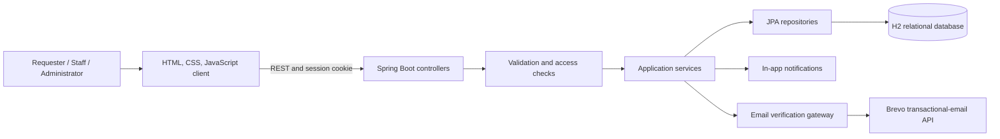
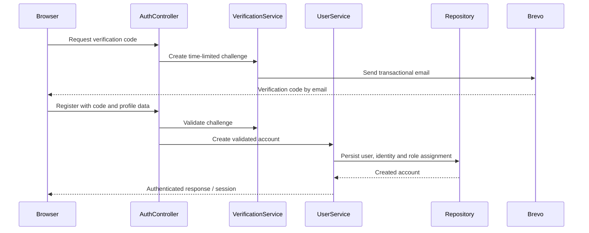

# Architecture

## System view

## Layer responsibilities

| Layer | Responsibility |
|---|---|
| Browser | Forms, client-side interaction, role-aware navigation, profile UI |
| Controller | REST contract, request parsing, session boundary, HTTP responses |
| Service | Registration, authentication, profile and workflow business rules |
| Repository | JPA/Hibernate persistence and domain lookup |
| Database | Users, identities, role assignments, tickets, history, evidence and notifications |
| Email gateway | Server-side verification-email delivery without exposing the API key to the browser |

## Identity and access slice

Secrets are supplied only to the back end through an ignored local environment file. The public portfolio includes neither the key nor the implementation source.

