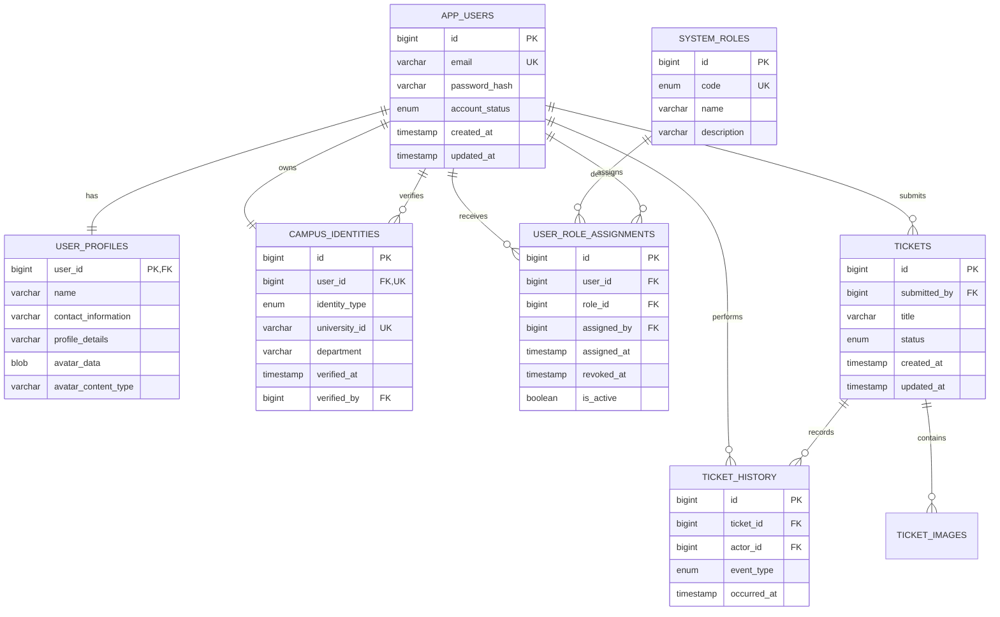

# CampusFix Database Normalization / 用户表拆分

## Overview

原有 `app_users` 同时保存 Authentication、Profile、Campus Identity、Role 和 Avatar。重构后，`app_users` 仅作为登录账户，其余职责拆分到独立关系表。现有 API 字段保持不变，因此前端无需修改。

## ERD

## Responsibilities

| Table | Responsibility |
|---|---|
| `app_users` | Authentication account, account status and timestamps |
| `user_profiles` | Display name, contact details, description and avatar |
| `campus_identities` | Student/Staff identity and verification information |
| `system_roles` | Authorisation role catalogue |
| `user_role_assignments` | Current and historical role allocation, including administrator and time |

## Compatibility and Data Integrity

- `app_users.id` is preserved, so `tickets.submitted_by` and `ticket_history.actor_id` remain valid.
- Public registration still creates `STUDENT + GENERAL_USER`.
- Admin updates create/revoke `user_role_assignments`; the change persists after re-login.
- Only one active role is allowed by the service layer, while previous assignments remain available as audit data.
- Existing plaintext passwords are converted to BCrypt hashes during migration.
- Profile, Avatar, Request and History APIs retain their existing request and response contracts.

## Legacy Migration

At first startup after this refactor:

1. The new relational tables are created.
2. Existing profile, identity and role data are copied using the same user IDs.
3. Existing passwords are converted to BCrypt.
4. Migration row counts are checked before legacy columns are removed.
5. Required account columns are changed to `NOT NULL`.

The migration is idempotent and can safely start again after a completed migration.
