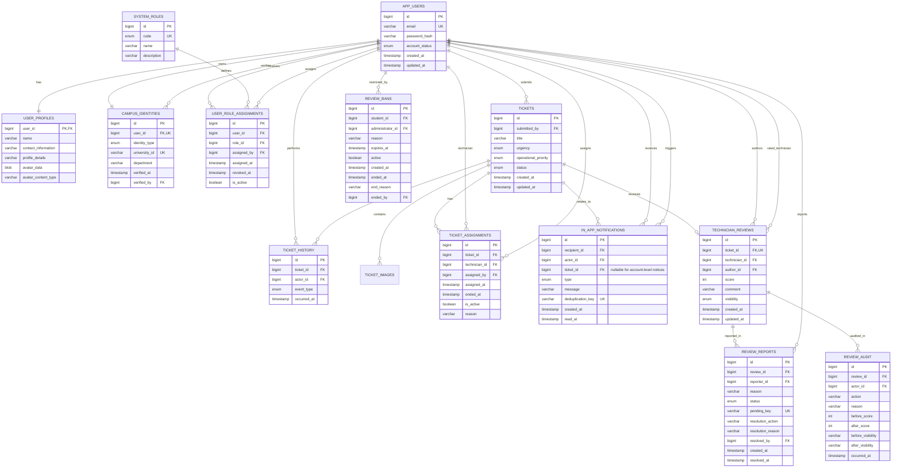

# CampusFix Database Normalization / 用户表拆分

## Overview

原有 `app_users` 同时保存 Authentication、Profile、Campus Identity、Role 和 Avatar。重构后，`app_users` 仅作为登录账户，其余职责拆分到独立关系表。现有 API 字段保持不变，因此前端无需修改。

## ERD

## Responsibilities

| Table | Responsibility |
|---|---|
| `app_users` | Authentication account, account status and timestamps |
| `user_profiles` | Display name, contact details, description and avatar |
| `campus_identities` | Student/Staff identity and verification information |
| `system_roles` | Authorisation role catalogue |
| `user_role_assignments` | Current and historical role allocation, including administrator and time |
| `ticket_assignments` | Current and historical Technician allocation, including assigning Administrator and time |
| `in_app_notifications` | Durable, deduplicated business events and student notification centre; `ticket_id` may be absent for account-level review bans |
| `technician_reviews` | One current review per completed ticket, linked to its author and final technician; visibility supports text-only or full removal |
| `review_reports` | Student reports and their resolution, with a unique pending key per reporter and review |
| `review_bans` | Time-limited or permanent review submission bans with administrator action history |
| `review_audit` | Before/after snapshots for rating changes, moderation and restoration |

## Compatibility and Data Integrity

- `app_users.id` is preserved, so `tickets.submitted_by` and `ticket_history.actor_id` remain valid.
- Public registration still creates `STUDENT + GENERAL_USER`.
- Admin updates create/revoke `user_role_assignments`; the change persists after re-login.
- An account may have several active role assignments; each request uses one selected active role, while previous assignments remain available as audit data.
- Existing plaintext passwords are converted to BCrypt hashes during migration.
- Profile, Avatar, Request and History APIs retain their existing request and response contracts.
- `tickets.operational_priority`独立于Requester填写的`urgency`，允许`NULL`表示尚未由Administrator分级，并建立`idx_tickets_operational_priority`索引。
- 初次分派使用独立`ticket_assignments`关系表；工单状态、Assignment、History和Notification在同一事务中保存。
- 评分汇总仅包含未被完整撤下的评价；只撤下评论时评分仍然有效。公开视图不返回作者或工单的身份字段。

## Legacy Migration

At first startup after this refactor:

1. The new relational tables are created.
2. Existing profile, identity and role data are copied using the same user IDs.
3. Existing passwords are converted to BCrypt.
4. Migration row counts are checked before legacy columns are removed.
5. Required account columns are changed to `NOT NULL`.

The migration is idempotent and can safely start again after a completed migration.
